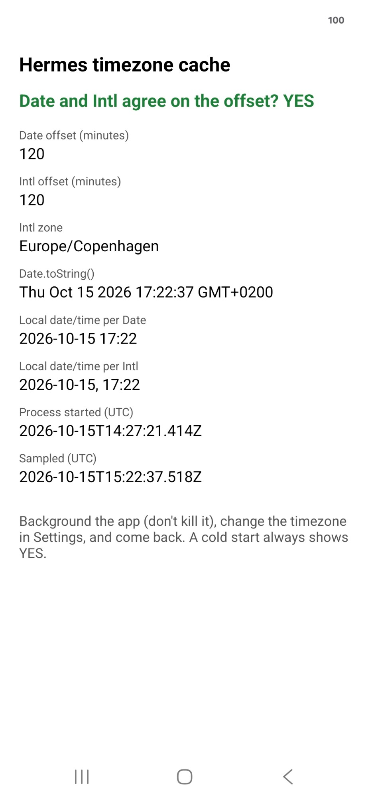
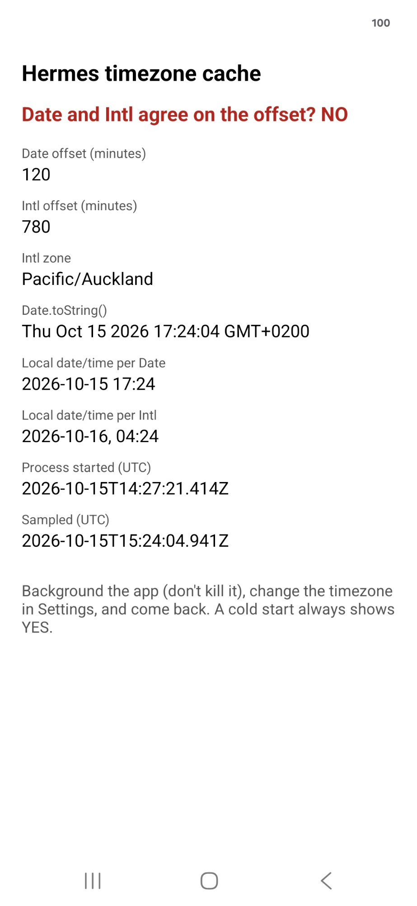
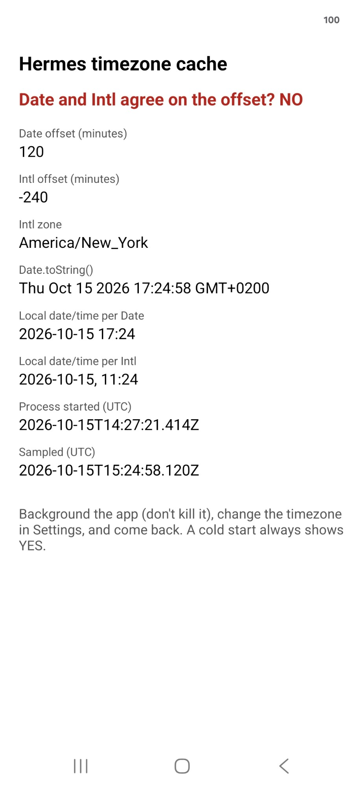
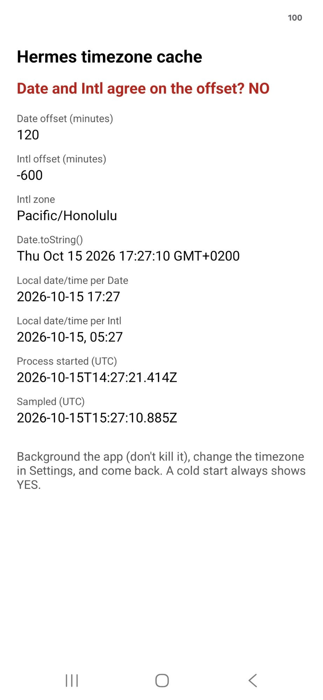

# rn-hermes-timezone-reset-repro


**React Native never resets Hermes' timezone cache.** After the device timezone changes while the
app process is alive, `Date` keeps using the **old** UTC offset until the app is cold started —
while a freshly built `Intl.DateTimeFormat` reports the **new** zone. Two standard APIs disagree
about the current zone inside the same process.

Hermes exposes `IHermes::resetTimezoneCache()` for exactly this and documents that "the
integration layer (e.g., React Native) must call this method" (`ReactCommon/jsi/jsi/hermes-interfaces.h`).
React Native does not call it. See facebook/hermes#1751 and react/react-native#55467.

This is a vanilla app from the
[React Native reproducer template](https://github.com/react-native-community/reproducer-react-native)
on **React Native 0.87.1**. The only change is [`ReproducerApp/App.tsx`](ReproducerApp/App.tsx):
one screen, standard JavaScript, no native code, no extra dependencies.

## Steps

1. Run the app on a **physical iOS device** (the iOS Simulator follows the Mac's timezone) or an
   **Android device/emulator**. The top line reads **YES**. Note "Process started".
2. Background the app — press Home, do **not** swipe it away.
3. In Settings, turn off automatic time zone and pick a different zone (Android: by hand in
   Settings; adb is denied on retail devices).
4. Return to the app. The top line reads **NO**: `Intl` reports the new zone, `Date` still uses the
   old offset. "Process started" is unchanged, so this is the same process.
5. Kill and relaunch: **YES** again.

Changing the zone by hand is not an artificial trigger: on arrival, automatic time zone sets the same
system setting and sends apps the same notification (`Intent.ACTION_TIMEZONE_CHANGED` /
`NSSystemTimeZoneDidChangeNotification`). This is what a user travelling with the app in the
background gets — compressed into a minute.

## Result — Galaxy S24, Android 16, Release build, 15 October 2026

One process throughout ("Process started" `2026-10-15T14:27:21.414Z` on every screen):

| # | Sampled (UTC) | Device zone (`Intl`) | `Intl` offset | **`Date` offset** | `Intl` local time | **`Date` says** | Agree? |
|---|---|---|---|---|---|---|---|
| 1 | 15:22:37 | Europe/Copenhagen | +120 | +120 | 15 Oct 17:22 | Thu Oct 15 17:22 GMT+0200 | YES |
| 2 | 15:24:04 | Pacific/Auckland | +780 | **+120** | **16 Oct** 04:24 | Thu Oct 15 17:24 GMT+0200 | **NO** |
| 3 | 15:24:58 | America/New_York | −240 | **+120** | 15 Oct 11:24 | Thu Oct 15 17:24 GMT+0200 | **NO** |
| 4 | 15:27:10 | Pacific/Honolulu | −600 | **+120** | 15 Oct 05:27 | Thu Oct 15 17:27 GMT+0200 | **NO** |
| 5 | 15:28:10 | Europe/Copenhagen | +120 | +120 | 15 Oct 17:28 | Thu Oct 15 17:28 GMT+0200 | YES |

`Date` never leaves the starting zone. Row 2 is already 16 October in Auckland while `Date` says the
15th. Row 5 only "agrees" because the device returned to the zone `Date` was stuck in.

| Copenhagen | Auckland | New York | Honolulu | Copenhagen |
|---|---|---|---|---|
|  |  |  |  |  |

The same staleness was measured on an iPhone 17e (iOS) with React Native 0.85.1 on 2026-08-12:
`getTimezoneOffset()` stayed at +120 after a Copenhagen → Sydney change (true +600).

## Run it

```sh
cd ReproducerApp
yarn install
# Android (Release embeds the bundle — no Metro needed)
yarn react-native run-android --mode release
# iOS (physical device)
cd ios && pod install && cd ..
yarn react-native run-ios --mode Release --device
```
