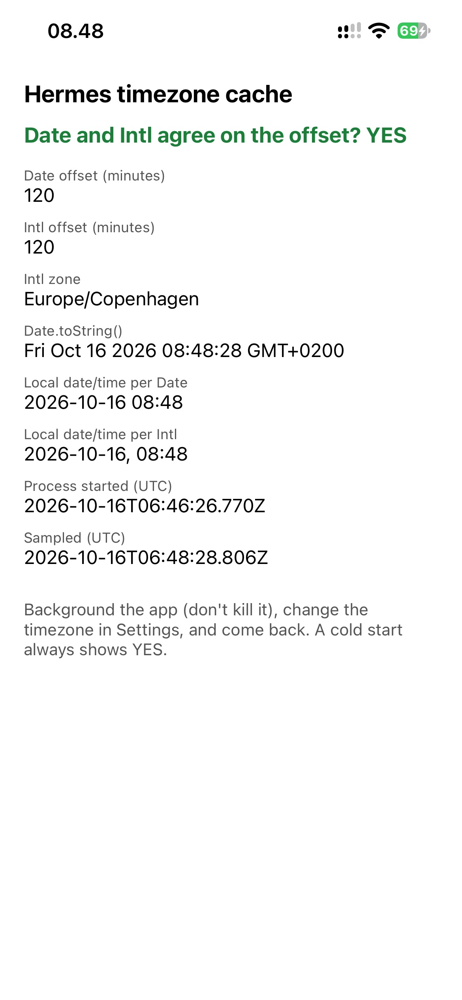
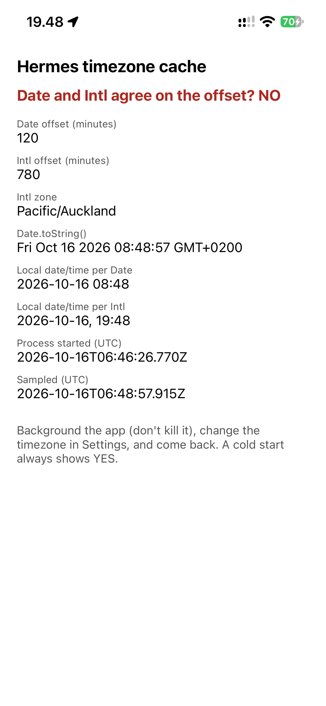
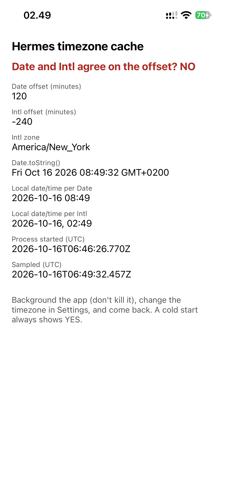
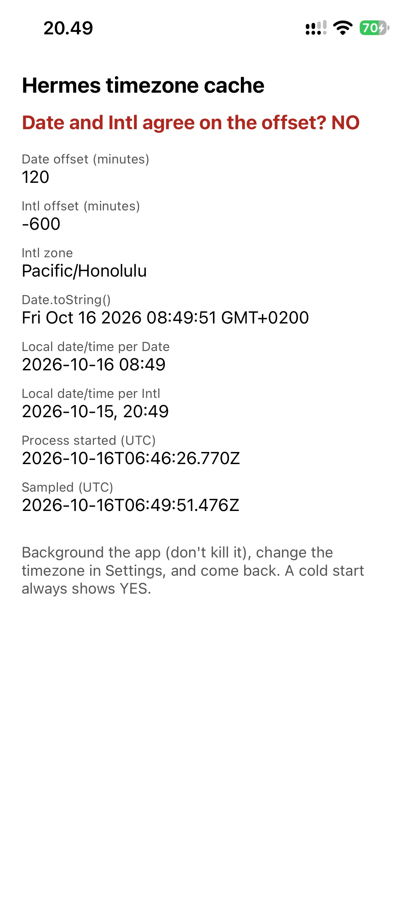
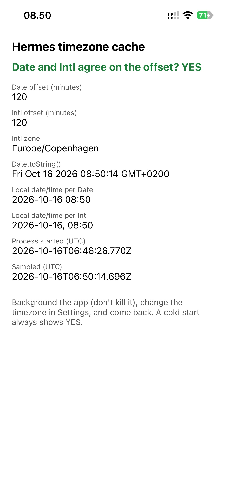
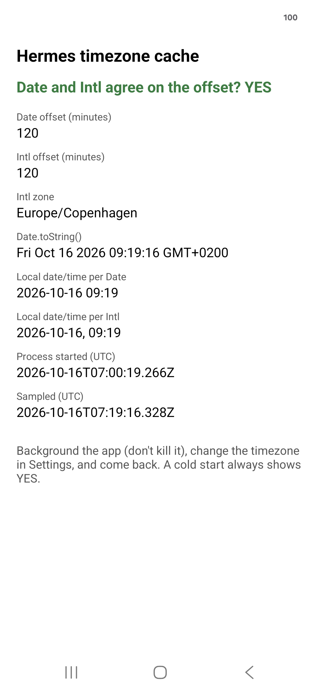
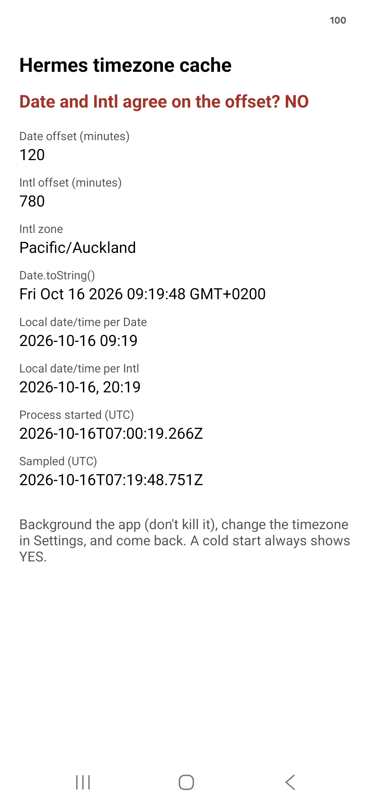
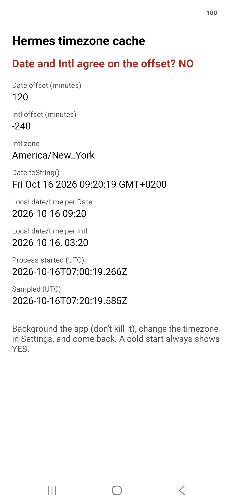
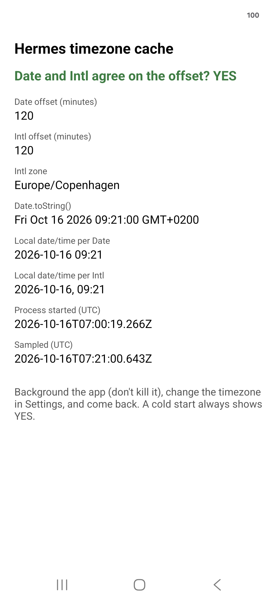

# rn-hermes-timezone-reset-repro


**React Native never resets Hermes' timezone cache.** After the device timezone changes while the
app process is alive, `Date` keeps using the **old** UTC offset until the app is cold started —
while a freshly built `Intl.DateTimeFormat` reports the **new** zone. Two standard APIs disagree
about the current zone inside the same process.

Hermes exposes `IHermes::resetTimezoneCache()` for exactly this and documents that "the
integration layer (e.g., React Native) must call this method" (`ReactCommon/jsi/jsi/hermes-interfaces.h`).
React Native does not call it. See facebook/hermes#1751 and react/react-native#55467.

This is a vanilla app from the
[React Native reproducer template](https://github.com/react-native-community/reproducer-react-native)
on **React Native 0.88.0**. The only change is [`ReproducerApp/App.tsx`](ReproducerApp/App.tsx):
one screen, standard JavaScript, no native code, no extra dependencies.

## Steps

1. Run the app on a **physical iOS device** (the iOS Simulator follows the Mac's timezone) or an
   **Android device/emulator**. The top line reads **YES**. Note "Process started".
2. Background the app — press Home, do **not** swipe it away.
3. In Settings, turn off automatic time zone and pick a different zone (Android: by hand in
   Settings; adb is denied on retail devices).
4. Return to the app. The top line reads **NO**: `Intl` reports the new zone, `Date` still uses the
   old offset. "Process started" is unchanged, so this is the same process.
5. Kill and relaunch: **YES** again.

Changing the zone by hand is not an artificial trigger: on arrival, automatic time zone sets the same
system setting and sends apps the same notification (`Intent.ACTION_TIMEZONE_CHANGED` /
`NSSystemTimeZoneDidChangeNotification`). This is what a user travelling with the app in the
background gets — compressed into a minute.

## Result — React Native 0.88.0, iOS and Android, 16 October 2026

Release builds, one process per device throughout (the "Process started" value is identical on
every screen), zone changed by hand in Settings: Copenhagen → Auckland → New York → Honolulu →
Copenhagen.

### iOS — iPhone 17e (physical device)

| # | Sampled (UTC) | Device zone (`Intl`) | `Intl` offset | **`Date` offset** | `Intl` local time | **`Date` says** | Agree? |
|---|---|---|---|---|---|---|---|
| 1 | 06:48:28 | Europe/Copenhagen | +120 | +120 | 16 Oct 08:48 | Fri Oct 16 08:48 GMT+0200 | YES |
| 2 | 06:48:57 | Pacific/Auckland | +780 | **+120** | 16 Oct 19:48 | Fri Oct 16 08:48 GMT+0200 | **NO** |
| 3 | 06:49:32 | America/New_York | −240 | **+120** | 16 Oct 02:49 | Fri Oct 16 08:49 GMT+0200 | **NO** |
| 4 | 06:49:51 | Pacific/Honolulu | −600 | **+120** | **15 Oct** 20:49 | Fri Oct 16 08:49 GMT+0200 | **NO** |
| 5 | 06:50:14 | Europe/Copenhagen | +120 | +120 | 16 Oct 08:50 | Fri Oct 16 08:50 GMT+0200 | YES |

The iPhone's own status-bar clock shows the correct local time in the same screenshot — 19.48 in
Auckland, 02.49 in New York, 20.49 in Honolulu — while `Date` reports 08:48–08:49. The OS knows the
time; only the JavaScript engine is stuck.

| Copenhagen | Auckland | New York | Honolulu | Copenhagen |
|---|---|---|---|---|
|  |  |  |  |  |

### Android — Galaxy S24, Android 16

| # | Sampled (UTC) | Device zone (`Intl`) | `Intl` offset | **`Date` offset** | `Intl` local time | **`Date` says** | Agree? |
|---|---|---|---|---|---|---|---|
| 1 | 07:19:16 | Europe/Copenhagen | +120 | +120 | 16 Oct 09:19 | Fri Oct 16 09:19 GMT+0200 | YES |
| 2 | 07:19:48 | Pacific/Auckland | +780 | **+120** | 16 Oct 20:19 | Fri Oct 16 09:19 GMT+0200 | **NO** |
| 3 | 07:20:19 | America/New_York | −240 | **+120** | 16 Oct 03:20 | Fri Oct 16 09:20 GMT+0200 | **NO** |
| 4 | 07:20:43 | Pacific/Honolulu | −600 | **+120** | **15 Oct** 21:20 | Fri Oct 16 09:20 GMT+0200 | **NO** |
| 5 | 07:21:00 | Europe/Copenhagen | +120 | +120 | 16 Oct 09:21 | Fri Oct 16 09:21 GMT+0200 | YES |

| Copenhagen | Auckland | New York | Honolulu | Copenhagen |
|---|---|---|---|---|
|  |  |  |  |  |

On both platforms `Date` never leaves the starting zone. Row 4 is a wrong calendar date — still
15 October in Honolulu, `Date` says the 16th. Row 5 only "agrees" because the device returned to
the zone `Date` was stuck in.

Also reproduced on React Native 0.87.1 (Galaxy S24, 15 October 2026), and measured on an iPhone 17e
with React Native 0.85.1 (2026-08-12).

## Run it

```sh
cd ReproducerApp
yarn install
# Android (Release embeds the bundle — no Metro needed)
yarn react-native run-android --mode release
# iOS (physical device)
cd ios && pod install && cd ..
yarn react-native run-ios --mode Release --device
```
